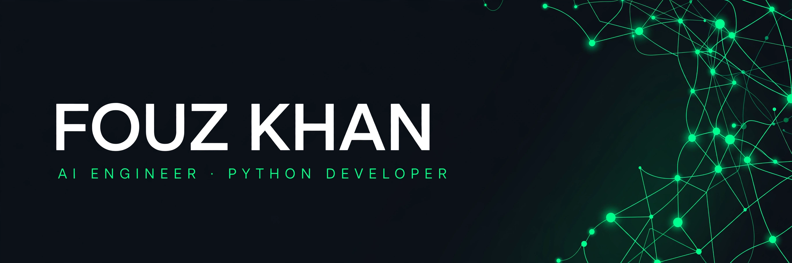

  

🎓 **BS Artificial Intelligence** — University of Layyah (2025–2029) · Pakistan

*My study account — coursework, practice code, and learning in public.*
Main profile → [@fouzkhan-dev](https://github.com/fouzkhan-dev)

### About

I'm an AI undergraduate learning by doing — coursework first, small experiments second, everything documented here as I go.

I use daily: **Python, Git, GitHub, VS Code, Linux.**

### Currently Learning

- **Python** — programming fundamentals through my BS AI coursework
- **Machine learning basics** — how models learn, in theory and in code
- **How LLMs work** — the ideas behind modern AI, one concept at a time

### Tech Stack

### GitHub Stats

### Connect

  
  

